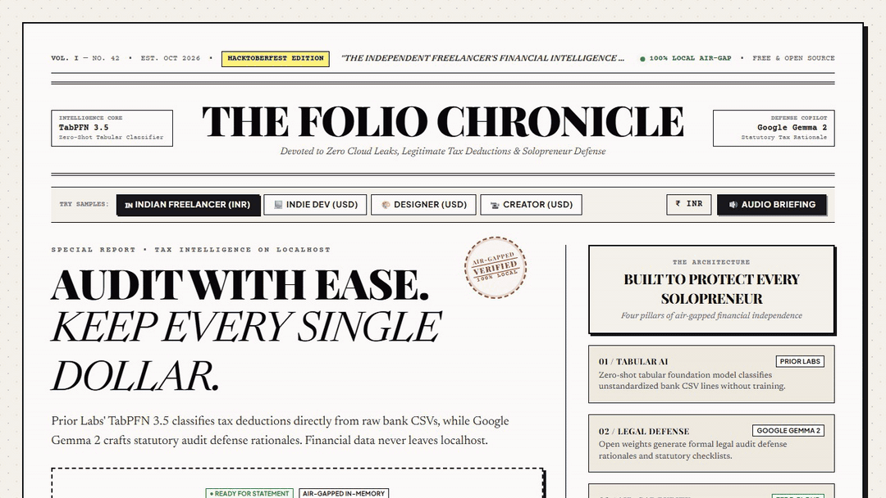
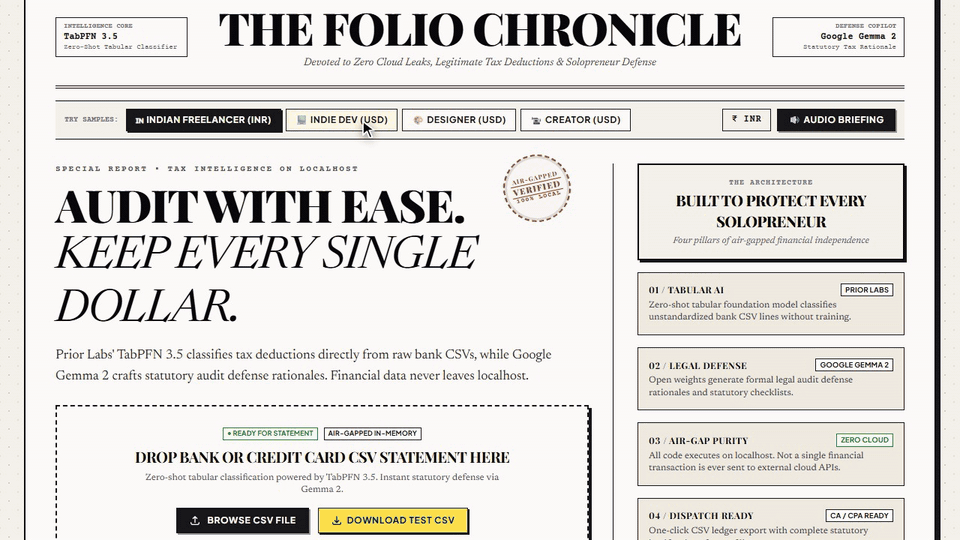
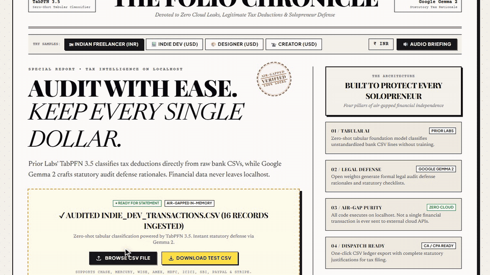
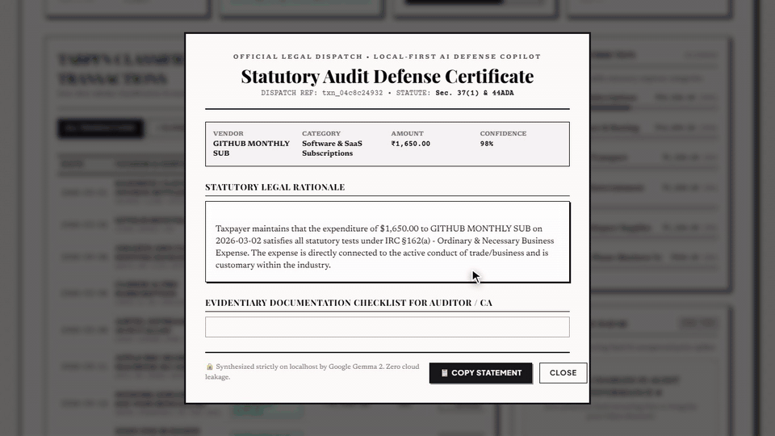

# folio

A free, air-gapped tax auditor for freelancers and indie hackers. Drop your bank statement on the broadsheet, and TabPFN classifies every write-off while Gemma writes the legal defense for your CA or the IRS.

**Try it:** https://folio-ai.onrender.com



## What's inside

- **The whole audit as a morning newspaper.** A vintage broadsheet gazette layout instead of a cold corporate dashboard. Columns, editorial headlines, volume tickers, and a red "AIR-GAPPED 100% LOCAL" rubber stamp.
- **Drop a statement, get instant write-offs.** Drop in raw CSV exports from Chase, Mercury, Wise, Stripe, Razorpay, HDFC, or ICICI. Prior Labs' TabPFN 3.5 foundation model reads unstandardized bank lines and flags allowable write-offs with calibrated confidence scores.
- **A legal defense certificate for every expense.** Click "Defend" and Google Gemma 2 synthesizes an official audit defense certificate citing exact statutory tax codes — Section 37(1) & 44ADA of the Indian Income Tax Act, or IRC §162(a) for IRS Schedule C.
- **Four preloaded freelancer editions.** One click switches between an Indian tech freelancer (in ₹ INR), an indie developer running SaaS (in $ USD), a freelance designer, and a digital creator.
- **A phantom subscription radar.** Catches zombie recurring SaaS charges, sneaky price increases, and accidental personal expenses before tax season hits.
- **A 30-second spoken briefing.** Click audio briefing to hear a spoken recap of your total allowable deductions and money kept.
- **Accountant-ready export.** One click downloads a clean, itemized CSV deduction schedule formatted for tax filing.
- **Zero cloud leaks.** Runs completely on your own machine. Your bank transactions, invoices, and balances never touch closed cloud servers or training pipelines.
- **No login, no accounts, and no monthly fees.** Everything runs in your browser and on localhost.

## A quick look

**Drop a bank statement or browse a sample**



**Switch between INR and USD with one click**



**Click Defend to get a statutory certificate from Gemma**


**Copy the statement with one click**



## How it works

Financial auditing has two hard problems that closed cloud LLMs handle poorly:

First, general-purpose chat models stumble on raw numerical tables. They hallucinate totals, swap debits with credits, and require complex prompt engineering just to parse a messy CSV line. **Prior Labs' TabPFN 3.5** fixes this because it is a foundation model trained specifically on tabular data. It understands banking distributions zero-shot without fine-tuning, classifying unstandardized vendor strings with calibrated confidence percentages.

Second, sending confidential bank statements, client names, and income records to closed third-party cloud APIs creates real privacy risks for freelancers. **Google Gemma 2** runs with open weights to generate formal statutory audit defense rationales on localhost, grounding every deduction in specific statutory language (Section 37(1) for Indian freelance expenses, or IRC §162 for US solopreneurs).

Every model output is validated through Pydantic schemas before reaching the page. If a bank CSV has missing fields or unexpected headers, the parsing engine normalizes dates, currencies, and amounts automatically so the numbers on the broadsheet always match your statement.

## Running it locally

```bash
git clone https://github.com/pyarchana/folio-ai.git
cd folio-ai
pip install -r requirements.txt
python run.py
```

Open `http://127.0.0.1:8000` in your browser.

To run the test suite:

```bash
python -m pytest tests/
```

## License

MIT
